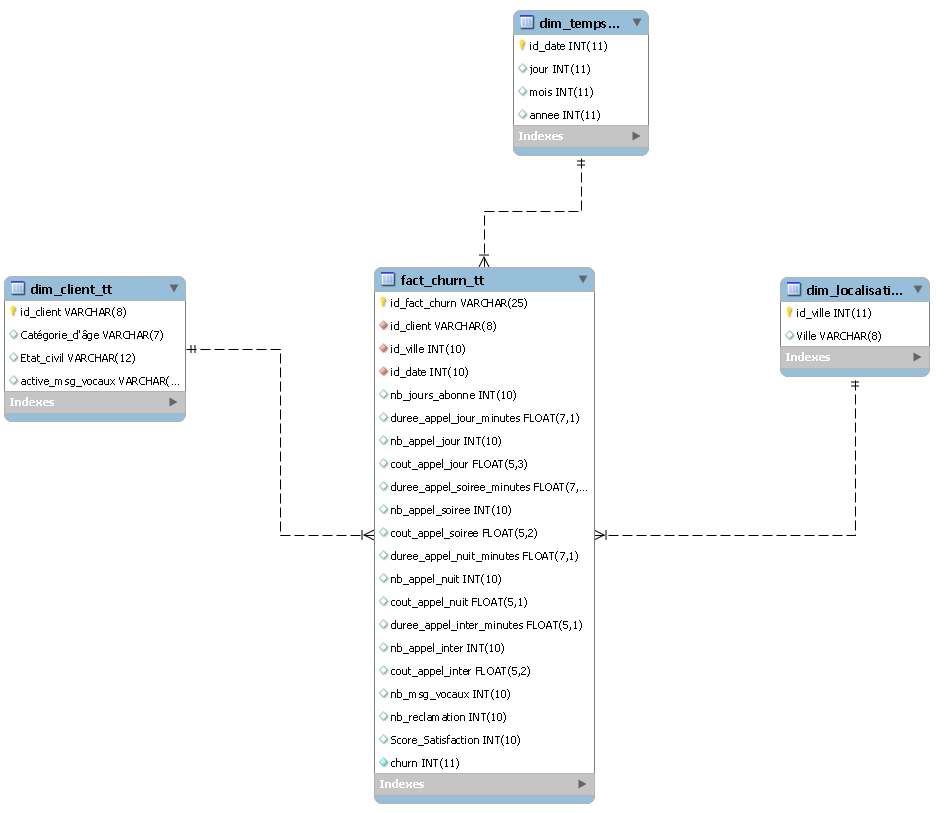

# 📉 Prédiction du churn – Tunisie Télécom

Projet de **Business Intelligence et Data Science** : prédire quels clients d'un opérateur télécom risquent de **quitter** leur abonnement (c'est le *churn*).

**Auteure :** Malak Saidani

---

## 📌 Sommaire

1. [Contexte et objectif](#-contexte-et-objectif)
2. [Contenu du dépôt](#-contenu-du-dépôt)
3. [Les données](#-les-données)
4. [Modèle en étoile (entrepôt de données)](#-modèle-en-étoile-entrepôt-de-données)
5. [Notebook de prédiction](#-notebook-de-prédiction)
6. [Résultats](#-résultats)
7. [Tableau de bord Power BI](#-tableau-de-bord-power-bi)
8. [Comment lancer le projet](#-comment-lancer-le-projet)
9. [Outils utilisés](#-outils-utilisés)
10. [Pistes d'amélioration](#-pistes-damélioration)

---

## 🎯 Contexte et objectif

Quand un client quitte son opérateur, l'entreprise perd de l'argent. Il coûte aussi plus cher de trouver un nouveau client que de garder un client actuel.

**Objectif :** utiliser les données des clients (appels, coûts, réclamations, satisfaction…) pour **prévoir qui va partir**, afin de pouvoir lui proposer une offre avant son départ.

Le projet suit 3 grandes étapes :

| Étape | Ce qu'on fait |
|---|---|
| 1. **ETL** | Nettoyer et préparer les données, puis les ranger dans un entrepôt de données |
| 2. **Analyse et prédiction** | Étudier les données et entraîner des modèles de Machine Learning |
| 3. **Visualisation** | Montrer les résultats dans un tableau de bord Power BI |

---

## 📁 Contenu du dépôt

```
churn-telecom/
├── data/         Données brutes et données après ETL
├── notebooks/    Notebook Jupyter de prédiction du churn
├── models/       Meilleur modèle sauvegardé (.pkl)
├── powerbi/      Tableau de bord (.pbix)
├── docs/         Schéma du modèle en étoile
├── talend/        Projet Talend (jobs ETL
├── requirements.txt
└── README.md
```

| Dossier / fichier | Description |
|---|---|
| `data/dataset_telecom.csv` | Données **brutes** (5000 clients, 23 colonnes) |
| `data/dataset_telecom_apres_etl.xlsx` | Données **nettoyées** après ETL (5000 clients, 18 colonnes) |
| `notebooks/prediction_churn.ipynb` | Analyse des données + 4 modèles de prédiction |
| `models/meilleur_modele_churn.pkl` | Meilleur modèle, prêt à être réutilisé |
| `powerbi/tableau_de_bord.pbix` | Tableau de bord interactif |
| `docs/modele_en_etoile.png` | Schéma de l'entrepôt de données |
| `requirements.txt` | Liste des bibliothèques Python à installer |

---

## 🗂️ Les données

- **5000 clients**, un client par ligne.
- La colonne à prédire s'appelle **`churn`** : `1` = le client est parti, `0` = il est resté.
- Seulement **environ 14 %** des clients sont partis (707 sur 5000). Les classes sont donc **déséquilibrées**.

### Colonnes utilisées pour la prédiction

| Type | Colonnes |
|---|---|
| Abonnement | `nb_jours_abonne` |
| Appels de jour | `nb_appel_jour`, `duree_appel_jour_minutes`, `cout_appel_jour` |
| Appels de soirée | `nb_appel_soiree`, `duree_appel_soiree_minutes`, `cout_appel_soiree` |
| Appels de nuit | `nb_appel_nuit`, `duree_appel_nuit_minutes`, `cout_appel_nuit` |
| Appels internationaux | `nb_appel_inter`, `duree_appel_inter_minutes`, `cout_appel_inter` |
| Service client | `nb_msg_vocaux`, `nb_reclamation`, `Score_Satisfaction` |

### Qu'est-ce que l'ETL a changé ?

| Avant (fichier brut) | Après (fichier ETL) |
|---|---|
| Quelques valeurs manquantes | Aucune valeur manquante |
| Noms de colonnes avec accents et parenthèses (`durée_appel_jour(minutes)`) | Noms simples (`duree_appel_jour_minutes`) |
| `churn` écrit `True.` / `False.` | `churn` en `1` / `0` |
| Infos du client, de la ville et de la date dans la même table | Ces infos sont rangées dans des **tables de dimensions** (voir ci-dessous) |

---

## ⭐ Modèle en étoile (entrepôt de données)

Les données sont organisées en **étoile** : une grande table au centre (les faits) et des petites tables autour (les dimensions).



| Table | Rôle | Contenu principal |
|---|---|---|
| `fact_churn_tt` | **Table de faits** (au centre) | Appels, coûts, réclamations, satisfaction, `churn` |
| `dim_client_tt` | Dimension client | Catégorie d'âge, état civil, messagerie vocale activée |
| `dim_localisation_tt` | Dimension localisation | Ville |
| `dim_temps_tt` | Dimension temps | Jour, mois, année |

Les tables sont reliées par des clés : `id_client`, `id_ville` et `id_date`.

---

## 📓 Notebook de prédiction

Fichier : [`notebooks/prediction_churn.ipynb`](notebooks/prediction_churn.ipynb)

Il est écrit en français, avec des explications simples avant chaque partie :

| # | Partie | Ce qu'on y fait |
|---|---|---|
| 1 | Objectif | Expliquer le problème |
| 2 | Bibliothèques | Importer les outils Python |
| 3 | Chargement | Lire les données après ETL |
| 4 | Exploration | Tailles, types, valeurs manquantes, doublons |
| 5 | Variable cible | Voir combien de clients sont partis |
| 6 | Analyse des variables | Graphiques, comparaison restés / partis, corrélations |
| 7 | Préparation | Séparer entraînement (80 %) et test (20 %) |
| 8 | Modélisation | Entraîner 4 modèles |
| 9 | Comparaison | Accuracy, précision, rappel, F1, AUC, courbes ROC |
| 10 | Courbes d'apprentissage | Vérifier que les modèles apprennent bien |
| 11 | Importance des variables | Voir ce qui influence le plus le churn |
| 12 | Sauvegarde | Enregistrer le meilleur modèle et l'utiliser sur des exemples |
| 13 | Conclusion | Résumer ce qu'on a appris |

### Les 4 modèles testés

| Modèle | Idée simple |
|---|---|
| **Régression logistique** | Calcule une probabilité de départ avec une formule |
| **KNN** | Regarde les clients les plus proches (le meilleur `k` est cherché automatiquement) |
| **Arbre de décision** | Pose une suite de questions oui/non (la meilleure profondeur est cherchée avec `GridSearchCV`) |
| **Forêt aléatoire** | Beaucoup d'arbres qui votent ensemble |

### Bonnes pratiques utilisées

- **Séparation stratifiée** : la proportion de clients partis (~14 %) est la même dans l'entraînement et dans le test.
- **Pipeline avec standardisation** : l'échelle des variables est apprise uniquement sur l'entraînement (pas de fuite d'information vers le test).
- **Plusieurs métriques** : comme les classes sont déséquilibrées, on ne regarde pas seulement l'accuracy.

---

## 🏆 Résultats

Scores sur le jeu de test (1000 clients) :

| Modèle | Accuracy | Précision | Rappel | F1-score | AUC |
|---|---|---|---|---|---|
| **Forêt aléatoire** | **0.931** | **0.919** | **0.560** | **0.696** | **0.875** |
| Arbre de décision | 0.913 | 0.829 | 0.482 | 0.610 | 0.820 |
| KNN | 0.891 | 0.742 | 0.348 | 0.473 | 0.764 |
| Régression logistique | 0.866 | 0.621 | 0.128 | 0.212 | 0.757 |

> Les résultats peuvent varier très légèrement selon la version des bibliothèques.

### Comment lire ces scores ?

- **Accuracy** : part des prédictions correctes.
- **Précision** : quand le modèle dit « ce client va partir », il a raison dans 92 % des cas (forêt aléatoire).
- **Rappel** : parmi les clients qui sont vraiment partis, le modèle en retrouve environ 56 %.
- **AUC** : capacité à séparer les clients qui partent de ceux qui restent (0.5 = hasard, 1 = parfait).

### Ce qu'on retient

- ✅ La **forêt aléatoire** est le meilleur modèle sur ces données.
- ⚠️ L'accuracy seule est trompeuse : un modèle qui dirait toujours « le client reste » aurait déjà environ 86 %. C'est pour cela qu'on regarde aussi le rappel et le F1-score.
- 🔑 Les variables sur les **réclamations**, la **satisfaction** et l'**usage des appels** aident le plus à repérer un client à risque (voir le graphique d'importance dans le notebook).

---

## 📊 Tableau de bord Power BI

Fichier : [`powerbi/tableau_de_bord.pbix`](powerbi/tableau_de_bord.pbix)

Le tableau de bord présente les indicateurs (KPI) sur le churn. Pour l'ouvrir, il faut **Power BI Desktop** (gratuit, Windows).

---

## 🚀 Comment lancer le projet

### 1. Télécharger le projet

```bash
git clone https://github.com/MalakSaidani26/churn-telecom.git
cd churn-telecom
```

### 2. Installer les bibliothèques

```bash
pip install -r requirements.txt
```

### 3. Ouvrir le notebook

```bash
cd notebooks
jupyter notebook prediction_churn.ipynb
```

Puis choisir **Cell → Run All** pour tout exécuter.

> ℹ️ Le notebook doit être lancé **depuis le dossier `notebooks/`**, car il lit les données avec le chemin `../data/`.

### 4. Utiliser le modèle sauvegardé (sans ré-entraîner)

```python
import joblib
import pandas as pd

modele = joblib.load("models/meilleur_modele_churn.pkl")

# clients = DataFrame avec les 16 colonnes de prédiction (voir le tableau des colonnes)
probabilite_depart = modele.predict_proba(clients)[:, 1]
```

---

## 🛠️ Outils utilisés

| Domaine | Outils |
|---|---|
| ETL | Talend |
| Entrepôt de données | Modèle en étoile (MySQL) |
| Analyse et Machine Learning | Python, pandas, NumPy, scikit-learn |
| Graphiques | Matplotlib, Seaborn |
| Tableau de bord | Power BI |
| Notebook | Jupyter |


## 👩‍💻 Auteure

**Malak Saidani** 
🔗 [LinkedIn](https://www.linkedin.com/in/malak-saidani-019b68334) · 🐙 [GitHub](https://github.com/MalakSaidani26)
